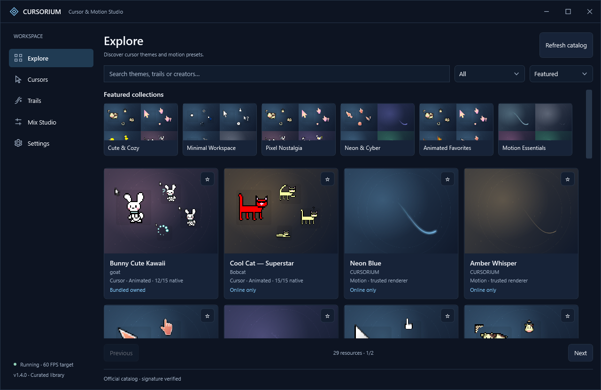

# CURSORIUM — Cursor & Motion Studio

Windows 鼠标主题与桌面特效管理工具，沿用原 FROST 项目的 **C# / .NET 8 / WPF / Win32**。在线发现、校验下载，本地预览与应用；无账户、注入或主题脚本。



源码：[catvir4493/cursorium](https://github.com/catvir4493/cursorium)。安装器与便携版：[GitHub Releases](https://github.com/catvir4493/cursorium/releases)。原 FROST 项目与历史继续保留在 [frost-white-comet](https://github.com/catvir4493/frost-white-comet)。

v1.1 的 UI、状态与窗口框架升级、同尺寸前后对照和页面截图见 [交付记录](docs/CURSORIUM-v1.1-DELIVERY.md) 与 [截图对照](docs/CURSORIUM-v1.1-SCREENSHOTS.md)。

当前版本 **v1.4.0 — Online Library Expansion & Curation**：29 项真实在线资源、6 个独立签名合集、版本绑定与安全更新、可复用审核发布工具。新增 9 套指针与 10 套原创拖尾；没有为达到 30 项而纳入未批准资源。见 [中文交付](docs/CURSORIUM-v1.4-DELIVERY.md)、[作者与授权台账](docs/CURSORIUM-v1.4-SOURCES.md)、[实际 WPF 截图](docs/CURSORIUM-v1.4-SCREENSHOTS.md)和[以后上架流程](docs/CURSORIUM-LIBRARY-WORKFLOW.md)。

v1.3.1 — Visual Experience Refinement：真实封面、首屏详情操作、像素放大观察、可点击角色画廊与更清晰的本地库；见 [中文交付](docs/CURSORIUM-v1.3.1-DELIVERY.md) 和 [同尺寸截图对照](docs/CURSORIUM-v1.3.1-SCREENSHOTS.md)。

v1.3.0 的 Discover & Install 工作流继续保留：Explore 发现资源 → 内部详情与按需真实预览 → Download → Cursors / Trails 本地库 → Apply Changes。官方 [资源库](https://github.com/catvir4493/cursorium-library) 与 [签名目录](https://catvir4493.github.io/cursorium-library/catalog/v1/index.json) 独立更新。完整功能、真实测试及限制见 [中文交付](docs/CURSORIUM-v1.3-DELIVERY.md) 和 [WPF 截图](docs/CURSORIUM-v1.3-SCREENSHOTS.md)。v1.2.1 及此前 tag / Release 保留。

v1.2 新增五套真实 Public Domain 可爱主题、分类/收藏、来源与角色详情、动画缩略预览、ZIP/目录映射确认导入。见 [中文交付报告](docs/CURSORIUM-v1.2-DELIVERY.md)、[来源与授权](docs/CURSORIUM-v1.2-SOURCES.md) 和 [实际截图](docs/CURSORIUM-v1.2-SCREENSHOTS.md)。

## 功能

- 完整保留 FROST / WHITE COMET 的 15 个指针角色、四种分辨率 CUR 和两个动画 ANI。第二套内置主题为 Obsidian。
- Comet、Minimal、Neon、Stardust 共用采样、时间驱动模型和渲染循环。
- 点击效果独立选择 Off / Soft Halo / Ring；左键单环、右键双环。
- 指针、拖尾与点击效果可自由组合；参数和颜色修改先更新应用内预览，**Apply Changes** 才应用到系统。
- **Cancel Changes** 恢复已应用配置；Profile 支持 Create / Save / Rename / Delete。选择 Profile 先预览，再 Apply。
- 安全导入 `.cur` / `.ani`；验证文件结构、大小、热点和 Windows 加载结果。导入副本保存在本地，无脚本执行。
- 系统指针切换保存原始备份；逐次事务日志支持部分失败回滚及下次启动恢复。
- 托盘支持启用/关闭、暂停/恢复、打开界面、恢复指针和退出；开机启动可选。

## 运行

便携版解压后运行 `FrostWhiteComet.exe`，保留整个目录。可执行文件名、安装目录、HKCU 启动项和 IPC 标识沿用原项目，便于升级现有安装；产品名称与 UI 为 CURSORIUM。

关闭窗口会保留托盘进程；Quit 会释放特效引擎，Windows 指针主题继续保留。Restore original cursors 恢复安装第一套主题前保存的配置，包括原注册表类型和原本不存在的值。已有 FROST 的备份继续有效。

安装器 `CURSORIUM-Setup-1.3.1-Release.exe` 按当前用户安装，无需管理员权限。安装本身不改变系统指针或默认开启登录启动。卸载先退出引擎并恢复备份；恢复失败时停止卸载。设置、导入主题、指针稳定副本与历史备份保留。

## 使用

1. Explore 搜索在线资源，打开详情；Try Live Preview 使用校验后的临时包。Download 只加入本地库，再 Open in Cursors / Trails 选择主题和预设。原有内置主题无需下载。
2. 右侧 Trail / Cursor / Click 分组调整组合；消散时间、粒子数等在 Advanced settings。中央 Live Preview 可移动和左右点击，角色下拉框可测试系统角色。
3. 按 Apply Changes。之后 Windows 指针和桌面效果使用该组合。
4. Mix Studio 输入名称并 Create，或选择已有 Profile 修改后 Save。Rename 修改名称；Delete 只删除保存的 Profile。

导入一个文件时，先在 Cursors 的角色下拉框选择要替换的角色。导入多个文件时使用角色名称，如 `Normal.cur`、`Text.cur`、`Busy.ani`；未替换的角色继承当前主题。也可使用 Import Cursor Pack 或 Import folder，检查逐角色映射并选择缺失角色的回退主题；冲突不自动选择。导入后选中新主题，按 Apply 即可应用。选择 Original system 会保留/恢复原指针配置。

拖尾开关与点击效果独立；Desktop effects 是总开关。托盘 Pause 是临时暂停，托盘 Enable 的状态会持久保存。开机启动注册立即生效；界面动画和系统标题栏偏好也立即保存；特效参数由 Apply 生效。Apply 和 Cancel 在没有草稿变化时禁用。

## 数据和扩展

```text
%LOCALAPPDATA%/FrostWhiteComet/
  settings.json                 旧版配置，首次读取时迁移，不覆盖
  studio.json                   schemaVersion 1，最后成功应用的配置
  profiles.json                 schemaVersion 1，独立的已保存 Profile
  interface.json                schemaVersion 1，界面动画与系统标题栏偏好
  original-theme.json           最初的 Windows 指针配置备份
  theme-transaction.json        未完成事务的恢复日志
  Backups/                      恢复后归档
  Themes/<stable-id>/            导入主题及 theme.json
  Theme/installed/<id>/<hash>/   不覆盖已使用文件的稳定原生指针资源
  MotionLibrary/<id>.json        下载的白名单拖尾参数，原子安装记录
  Online/catalog-cache.json      签名目录及原字节，可离线使用
  Online/Media/                  有界静态 PNG 缓存
  Online/Staging/session-*/       当前进程的临时下载和预览，不是个人库
  Theme/v1/                     旧版已安装资源，保留
  frost.log                     轮转错误日志
```

内置 FROST 的清单位于 `assets/cursors/theme.json`；其他普通主题放入 `assets/themes/<id>/theme.json`，无需修改 UI。主题必须提供 15 个已知角色，资源路径仅限目录内。效果清单位于 `assets/catalog/effects.json`；四种渲染类型由代码实现，预设参数来自 JSON。未来添加新渲染算法需要扩展渲染器，普通主题无需扩展代码。

架构、事务协议及扩展格式见 [CURSORIUM-ARCHITECTURE.md](docs/CURSORIUM-ARCHITECTURE.md)。交付和验收记录见 [CURSORIUM-DELIVERY.md](docs/CURSORIUM-DELIVERY.md) 与 [VALIDATION.md](VALIDATION.md)。原 FROST 的完整说明保存在 [LEGACY-FROST.md](docs/LEGACY-FROST.md)。

## 构建与验证

Windows + .NET 8 或更新 SDK；项目目标仍为 `net8.0-windows`。

```powershell
dotnet build Frost.sln -c Release
dotnet run --project src/Frost.App -c Release
dotnet run --project tests/Frost.Verify -c Release -- assets/cursors
dotnet run --project tests/Frost.Verify -c Release -- assets/themes/obsidian
powershell -NoProfile -ExecutionPolicy Bypass -File scripts/build-release.ps1
powershell -NoProfile -ExecutionPolicy Bypass -File scripts/verify-cursorium.ps1 -Discover
```

完成验证并提交后，`scripts/publish-github.ps1` 推送并核对远程 main；正式版本增加 `-Release -Version 1.3.0 -NotesPath docs/releases/1.3.0.md` 会上传并校验下载文件，再发布 GitHub Release。凭据由 Git Credential Manager 在内存中读取。项目持续发布约定保存在 `AGENTS.md`：之后每次迭代完成验证后自动提交和上传。

`build-release.ps1` 生成自包含 Windows x64 便携 ZIP、安装器、主题 ZIP、源码 ZIP 和 SHA256 校验文件。`verify-cursorium.ps1` 使用独立数据目录；原生切换测试暂时改变系统指针，在结束时恢复测试前配置；桌面测试会短暂移动鼠标并使用 SendInput。现有用户设置与备份通过前后哈希检查保护。

`scripts/verify-release.ps1` 是安装/卸载测试，要求没有现存安装和活动备份；本次未对用户的现存安装运行它。

目标 Windows 10 1703+ / Windows 11 x64；本次实测 Windows 11 build 26100、单屏 2560×1440、96 DPI。Windows 10、混合 DPI、多屏物理热插拔、安全桌面与游戏独占全屏仍需实机覆盖。紧凑 DIP 布局测试不能替代真实 DPI 硬件验证。全屏暂停是窗口范围启发式检测；不支持的环境安全暂停，不注入应用。
