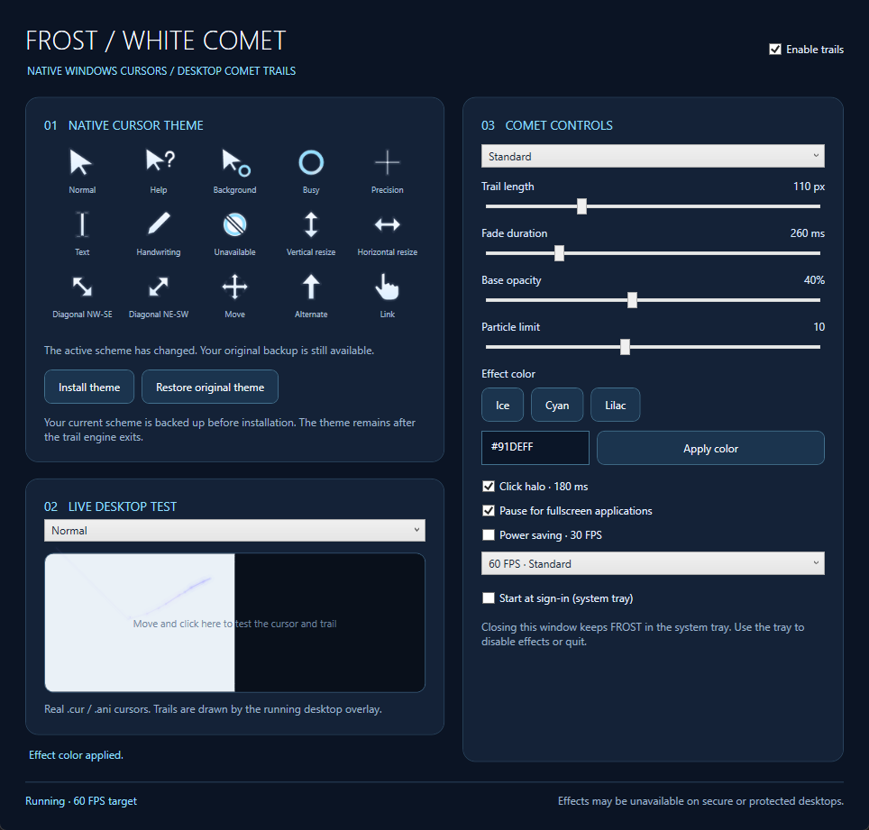

# FROST / WHITE COMET

A native Windows cursor theme and desktop comet trail engine built with **C# / .NET 8 / WPF / Win32**.

Real `.cur` and `.ani` cursors remain installed when the trail engine quits. A separate transparent desktop overlay draws restrained ice-blue filaments along actual mouse movement history. It does not replace the native pointer or control its input rate.



## Download and install

Download Windows x64 packages from [Releases](https://github.com/catvir4493/frost-white-comet/releases).

- **Installer:** `FrostWhiteComet-Setup-1.0.0-Release.exe`. Installs for the current user without administrator rights. Open **FROST - WHITE COMET** from the Start menu.
- **Portable:** extract `FrostWhiteComet-1.0.0-win-x64.zip`, then run `FrostWhiteComet.exe`. Keep the entire directory, including runtime DLLs, `Theme/`, and `frost.ico`.
- **Cursor theme only:** `FrostWhiteComet-CursorTheme-1.0.0.zip` contains cursors, vector sources, PNG previews, and role metadata.
- **Source:** clone this repository or download `FrostWhiteComet-Source-1.0.0.zip`.

Release packages include the .NET 8 Windows Desktop runtime; no separate .NET installation is required. The application uses a self-contained folder deployment to avoid the extra memory needed to decompress a compressed single-file runtime. The installer is a single executable.

Select **Install theme** in the control panel and confirm. FROST backs up the current cursor scheme before switching all 15 system roles. Installing the application does not automatically change cursors or enable startup at sign-in.

Closing the panel keeps FROST in the tray. The tray offers settings, trail on/off, presets, restoration, and quit. **Quitting stops effects; the installed cursor theme remains active.** **Restore original theme** restores the pre-installation backup and replaces any scheme selected manually afterward, with confirmation.

Uninstall through Windows Settings or run the installed `Uninstall.exe`. Uninstallation quits the engine, restores an active backup, and removes program files, the Start menu shortcut, and FROST's startup entry. Settings, logs, and archived backups remain. Uninstallation stops if restoration fails.

**Runtime target:** Windows 10 1703+ / Windows 11, x64. Tested on Windows 11 build 26100. Windows 10 and mixed-DPI hardware remain unverified; see [VALIDATION.md](VALIDATION.md).

## Native cursor theme

Artwork is generated from original vector geometry: ice-white fills, subtle inner shading, rounded joins, and a dark outline. The reference image informed the visual direction; it was not cropped or copied into assets.

Colors: White `#F7FAFF`, Outline `#243248`, Ice Blue `#91DEFF`, Cyan `#62CFFF`, Lavender `#B7A8FF`.

`assets/cursors/` contains **15 multi-resolution CUR files**, each with 32/48/64/96 px images. Busy and Working in Background also have **two ANI files**: 24 frames, 3 jiffies (50 ms) per frame, 1.2 seconds per rotation. Each animation frame contains all four resolutions. Installation uses ANI for these two roles; CUR provides static alternatives.

| System role | Installed file | Hotspot at 32 px (x, y) |
|---|---|---|
| Normal | Normal.cur | 4, 3 |
| Help | Help.cur | 4, 3 |
| Working in Background | Working.ani | 4, 3 |
| Busy | Busy.ani | 16, 16 |
| Precision | Precision.cur | 16, 16 |
| Text | Text.cur | 16, 16 |
| Handwriting | Handwriting.cur | 5, 26 |
| Unavailable | Unavailable.cur | 16, 16 |
| Vertical Resize | Vertical.cur | 16, 16 |
| Horizontal Resize | Horizontal.cur | 16, 16 |
| Diagonal NW-SE | DiagonalNWSE.cur | 16, 16 |
| Diagonal NE-SW | DiagonalNESW.cur | 16, 16 |
| Move | Move.cur | 16, 16 |
| Alternate Select | Alternate.cur | 16, 3 |
| Link Select | Link.cur | 12, 3 |

Hotspots scale proportionally and are rounded to integer pixels. Windows chooses the active size; FROST does not change pointer-size settings. CUR uses straight-alpha 32-bit BGRA DIBs with an AND mask, explicitly converted from WPF premultiplied pixels.

- `preview/*.png`: transparent previews.
- `vectors/*.svg`: editable static geometry; animated rings are represented by static markers.
- `manifest.json`: sizes, roles, hotspots, and animation metadata.
- `src/Frost.Core/CursorArtwork.cs`: authoritative drawing/animation source.

Individual files can be selected in Windows Mouse Properties. Installing through FROST is recommended for its backup. No unbacked-up registry-overwriting INF is included.

## Trail controls

| Preset | Maximum arc length (physical px) | Fade duration (ms) | Base opacity | Particle limit |
|---|---:|---:|---:|---:|
| Minimal | 65 | 180 | 22% | 2 |
| Standard (default) | 110 | 260 | 40% | 10 |
| Glow | 180 | 360 | 55% | 16 |

Controls apply immediately. Changing sliders selects **Custom**; colors include shortcuts and a `#RRGGBB` field. Click halos default to 180 ms and can be disabled separately. Older Chinese preset identifiers migrate to English without changing saved numeric parameters.

Trails follow actual movement history. Low speed shortens and dims the effect; high speed adds detail within the limits. Stopping fades samples naturally; cursor jumps disconnect the trail. History is capped at 256 points, particles at the selected limit, and simultaneous halos at eight.

Render targets are 60 FPS by default, 120 FPS for high-refresh displays, and 30 FPS in power-saving mode. WPF uses composition callbacks and a stable deadline limiter. Actual output depends on displays, DWM, transparent-window rendering, and load. The native pointer remains independent of effect rendering.

Positions use `GetPhysicalCursorPos`. Raw Input supplements high-frequency movement sampling and button notifications; `RIDEV_NOLEGACY` is not enabled and ordinary mouse/keyboard messages are not consumed.

Each display gets a layered overlay with `WS_EX_TRANSPARENT`, `WS_EX_NOACTIVATE`, and `WS_EX_TOOLWINDOW`, plus non-intercepting hit-test/activation responses. History uses global physical coordinates; drawing converts to the window's DPI-specific WPF DIPs. The manifest declares PerMonitorV2. Layout changes rebuild overlays and re-register input; power events run on the UI thread.

Fullscreen auto-pause detects another process's foreground window covering a display, excluding the desktop shell. This is a heuristic, not guaranteed game/exclusive-fullscreen detection. Secure desktops, exclusive fullscreen, protected/elevated applications, or special topmost windows may prevent effects. Input-desktop changes pause and clear trails. Manual disabling is available.

## Backup and system integration

FROST modifies affected current-user cursor values, its own named scheme, and its optional HKCU startup entry. It does not change acceleration, pointer size, scaling, display layout, or power plans.

Installation validates and copies resources to `%LOCALAPPDATA%/FrostWhiteComet/Theme/v1/`. Before changing HKCU, it atomically saves a durable backup recording each affected value's existence, original type, and contents. It updates `HKCU/Control Panel/Cursors`, then calls `SystemParametersInfo(SPI_SETCURSORS)`. Failure attempts rollback; the backup remains until successful restoration. Reinstallation does not overwrite an active backup. If an external scheme was selected while a backup remains, restore before reinstalling. Restored backups are archived.

Owned `LoadCursorFromFile` / `LoadImage(..., LR_LOADFROMFILE)` handles are destroyed after verification. Both bitmap handles from `GetIconInfo` are released. Shared `LoadCursor` handles are never destroyed. Installation uses registry/SPI rather than passing shared handles to `SetSystemCursor`, which consumes its supplied handle.

Exit releases Raw Input registration, event subscriptions, overlays, tray resources, WPF cursors, timers, and IPC. Single-instance IPC uses a current-user-only named pipe.

```text
%LOCALAPPDATA%/FrostWhiteComet/
  settings.json                 Parameters, saved after a 350 ms debounce
  original-theme.json           Active original-scheme backup
  Backups/original-*.json        Archived restored backups
  Theme/v1/                     Stable native cursor paths
  frost.log                     Error log, rotated at approximately 2 MB
  setup-result.json             Latest installer/uninstaller result
%LOCALAPPDATA%/Programs/FrostWhiteComet/
                                Installed application and runtime files
```

Invalid settings fall back to defaults or bounded values. Errors are reported and logged. The installer validates extraction paths and manages only its fixed directory with a FROST installation marker.

## Build from source

Requires Windows, a .NET 8 or newer SDK, and NuGet access. Development used SDK 10.0.103; projects target `net8.0-windows`.

```powershell
dotnet build Frost.sln -c Release
dotnet run --project tools/Frost.CursorGen -c Release -- assets/cursors
dotnet run --project src/Frost.App -c Release
dotnet run --project tests/Frost.Verify -c Release -- assets/cursors

# Self-contained application, cursor/source ZIPs, installer, checksums
powershell -NoProfile -ExecutionPolicy Bypass -File scripts/build-release.ps1
```

```text
src/Frost.Core/          Artwork/encoders, Win32, theme backup, settings, model
src/Frost.App/           WPF panel, overlays, Raw Input, tray, IPC
tools/Frost.CursorGen/   Reproducible cursor generator
tests/Frost.Verify/      Native loading, hotspots, dimensions, model/theme checks
installer/Frost.Setup/   Per-user EXE installer/uninstaller
scripts/                Build, packaging, interactive verification
assets/cursors/         CUR, ANI, SVG, PNG, role manifest
docs/images/            English control panel screenshot
artifacts/              Local packages and evidence (not tracked)
```

Commands: `--tray` starts in the tray; `--shutdown` asks the running instance to quit; `--restore-theme` restores an existing backup without a UI. The latter two are automation commands to use deliberately.

## Verification

See [VALIDATION.md](VALIDATION.md) for observed results and limits.

```powershell
# Temporarily installs and restores system cursors; refuses an active backup
dotnet run --project tests/Frost.Verify -c Release -- assets/cursors --install-roundtrip

src/Frost.App/bin/Release/net8.0-windows/FrostWhiteComet.exe --self-test --report artifacts/verification
src/Frost.App/bin/Release/net8.0-windows/FrostWhiteComet.exe --benchmark --report artifacts/verification
```

**Interactive tests temporarily move the actual mouse.** The self-test injects a click and character into a dedicated window to check pass-through, focus, keyboard input, halos, displays, fading, rebuilding, fullscreen pause, controls, and the tray. Mouse position and the previous settings file are restored. Avoid using the mouse during tests. GUI checks need an interactive desktop. `--fullscreen-probe` is a short-lived external test window.

For UI verification while another FROST instance is running, add `--isolated-test` to `--self-test`. It uses a separate test instance rather than opening the existing panel. The existing theme and running application are preserved; overlapping effects may appear briefly. Do not use this mode for performance benchmarking because another engine would distort the measurements.

`scripts/verify-release.ps1` tests packaged installation, native theme installation/restoration and engine exit, desktop behavior, benchmarks, and uninstallation. It temporarily changes cursor state, moves the pointer, and creates per-user installation entries. It refuses existing installations and active backups; run it on a controlled interactive desktop.

Verifier fixtures: `--install-only` intentionally leaves an installed theme/backup for subsequent uninstaller verification; `--compare-backup <path>` compares the restored state. The installer supports `--silent --no-launch`; the uninstaller supports `--uninstall --silent`. Release checksums are in `SHA256SUMS.txt`.

## Known limits

- Tested on Windows 11 with two 96 DPI displays. Windows 10, mixed 125%/150% DPI, negative-coordinate layouts, physical hotplug, sleep/resume, secure/protected/elevated interfaces, and exclusive fullscreen games remain unverified.
- 60/120 FPS are targets. Initial Standard benchmarks produced about 54 drawing requests per second. GPU presentation was not measured; invalidations are not displayed FPS.
- The two-display engine benchmark used about 160 MiB. A visible panel and screenshots increase this; it is not a few-megabyte utility.
- Short tests do not establish several-hour stability or leak-free operation.
- Executables are unsigned; unknown-publisher/SmartScreen prompts are possible. Trusted signing is needed for formal distribution.
- Application-supplied custom cursors can override system roles.

## Win32 references

- [Layered windows and pass-through](https://learn.microsoft.com/en-us/windows/win32/winmsg/window-features)
- [Extended window styles](https://learn.microsoft.com/en-us/windows/win32/winmsg/extended-window-styles)
- [Cursor APIs and ownership](https://learn.microsoft.com/en-us/windows/win32/menurc/cursors)
- [Raw Input overview](https://learn.microsoft.com/en-us/windows/win32/inputdev/about-raw-input)
- [Using Raw Input](https://learn.microsoft.com/en-us/windows/win32/inputdev/using-raw-input)

Original code and artwork are licensed under [MIT](LICENSE). The reference image is not included. Bundled .NET components retain upstream licenses and notices.
