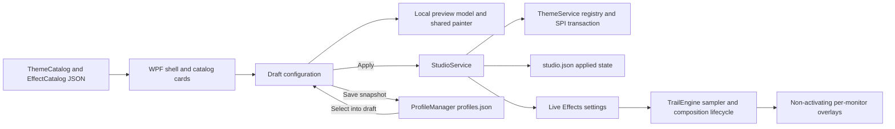

# CURSORIUM architecture

The original assemblies and namespaces remain `Frost.*`. This preserves installer, IPC,
backup and published executable compatibility while the product becomes CURSORIUM.
No new runtime dependency or UI framework was added.



## Services

| Module | Responsibility |
|---|---|
| `CursorTheme`, `ThemeCatalog` | Stable ID/name/author/description/preview/15 role mappings; directory discovery; path validation and safe file import. Invalid themes are skipped with a visible warning. |
| `CursorResource` | CUR directory/image bounds, hotspot checks, ANI RIFF/chunk/frame checks, size/frame limits, then native Windows loading. Only CUR/ANI are copied. |
| `ThemeService` | Immutable resources indexed by content hash; current-user registry values, named schemes, `SPI_SETCURSORS`, original backup, per-operation rollback and restart journal recovery. |
| `Settings`, `EffectCatalog` | Bounded numeric settings, four catalog presets, legacy preset migration and defensive deep copies. |
| `TrailModel` | Physical history capped at 256 samples, arc-length trimming, teleport separation, time-based expiry, at most eight click events. |
| `TrailEngine` | Shared Raw Input and physical sampling, one composition lifecycle, one transparent overlay per monitor, DPI conversion, fullscreen/default-input-desktop checks, tray pause. |
| `ClickEffectManager`, `ClickEffectPainter` | Independent Off/Halo/Ring lifecycle and drawing; button-down identity is retained. Left clicks draw one ring, right clicks two. |
| `StudioService` | Validates a draft; coordinates native transaction with applied JSON persistence; replaces live effects only on success. Controls persistent tray enable state. |
| `ProfileManager` | Atomic Create/Save/Rename/Delete; saved profiles own cloned configurations and survive a new process. |
| `MainWindow`, `LivePreview` | Three-column navigation/content/parameters; all controls connect to services. Preview owns a local model, runs only while visible with content, and never writes system state. |

## State boundaries

`MainWindow.Draft` is a deep copy of `StudioState.Applied`. Parameter and preset changes
modify that copy and the local preview. Saving a profile writes a separate snapshot;
it does not apply the draft. Selecting a profile copies it into the draft; Apply is
still required. Cancel copies the successfully applied state back into the draft.
Closing/reopening the panel retains the in-memory draft; restarting restores only
the successful applied state. A tray enable action updates the applied master switch
without discarding other draft edits. Tray pause is intentionally session-local.

The desktop renderer excludes the visible preview rectangle, including scroll clipping,
so an applied desktop effect does not appear over the draft preview. Outside that
rectangle it continues to use the successfully applied configuration.

On startup, Windows' installed cursor resources already persist independently of the
process. The app loads its saved effect configuration, recovers an interrupted transaction,
and does not silently reinstall a theme over a manually selected external Windows scheme.
If saved theme resources are missing, the original state is retained and a visible message
requires another selection/import before applying. Unknown state/profile schemas are
preserved and reported rather than overwritten with defaults.

## Native transaction

1. Validate/copy resources to an immutable `Theme/installed/<id>/<SHA256>/` directory.
2. Acquire the original current-user theme mutex. Recover any retained transaction.
3. Snapshot all affected cursor values (including existence and registry types), the
   original FROST scheme, and relevant CURSORIUM scheme entries. Atomically write and
   flush `theme-transaction.json` with previous registry, backup and applied-state text.
4. Create the original backup once; extend it with the pre-existing value of any newly
   introduced named scheme. Later switches retain the first original cursor values.
5. Write all roles and selected scheme, flush HKCU, reload with `SPI_SETCURSORS`.
6. Atomically save the new applied configuration. Delete the transaction to commit.
7. On any failure, restore registry values/types/absence, original-backup text and
   previous applied JSON. If rollback fails, retain the journal and report recovery failure.
   The next startup attempts the same recovery before constructing the UI.

Restoration uses the same transaction, archives the original backup and records the
system cursor selection while retaining effect parameters. Uninstall and the standalone
restore command also update a readable applied state. Uninstall aborts on failure.
Stable installed resources are deliberately retained because Windows can still refer
to them after an application exits or a portable folder moves.

JSON writes use a unique temporary file, flush it to disk and rename it in the same
directory. The registry is not a filesystem transaction; the durable journal bridges
partial failure and interrupted execution. External edits occurring during a transaction
cannot be isolated by Windows; operations are short and serial within this app.

## Theme schema example

```json
{
  "SchemaVersion": 1,
  "Id": "my-theme",
  "Name": "My Theme",
  "Author": "Local artist",
  "Description": "A native pointer suite",
  "Preview": "preview/Normal.png",
  "Roles": {
    "Normal": "Normal.cur",
    "Help": "Help.cur",
    "Working": "Working.ani",
    "Busy": "Busy.ani",
    "Precision": "Precision.cur",
    "Text": "Text.cur",
    "Handwriting": "Handwriting.cur",
    "Unavailable": "Unavailable.cur",
    "Vertical": "Vertical.cur",
    "Horizontal": "Horizontal.cur",
    "DiagonalNWSE": "DiagonalNWSE.cur",
    "DiagonalNESW": "DiagonalNESW.cur",
    "Move": "Move.cur",
    "Alternate": "Alternate.cur",
    "Link": "Link.cur"
  }
}
```

IDs use lowercase letters/digits/hyphens, are unique and remain stable across restarts.
Absolute paths, escaping paths and reparse-point resources are rejected. No package
code is loaded. Single-file import inherits missing roles from the selected local
theme (FROST when Original system is selected); multi-file import matches role filenames.
External Windows schemes remain recoverable in the backup; the library currently lists
the bundled and imported themes, rather than enumerating every Windows scheme.

## Input, rendering and resources

Keep `RIDEV_INPUTSINK`, omit `RIDEV_NOLEGACY`, and leave input messages unconsumed.
Overlays retain layered/transparent/no-activate/tool-window styles plus transparent hit
testing. Coordinates remain global physical pixels until each painter converts to DIPs.
Display rebuild and power callbacks marshal to the WPF dispatcher. Fullscreen detection
uses the existing non-shell foreground-window bounds heuristic; unavailable input
desktops pause/clear effects. There is no process injection or input remapping.

Rendering attaches only with pending content and detaches after expiry. Disabled effects
sample at about 4 Hz and hide overlays; pause lowers sampling and hides them. Frozen pens
and brushes are cached and quantized, particle drawings are capped at 24, and click events
at eight. Stardust drift/fade uses elapsed time, sharing the same sampled movement history.
120/60/30 are scheduling targets, not guarantees of GPU presentation.

Owned validation handles use `LoadImage` without `LR_SHARED`, then `DestroyCursor`.
Shared system `LoadCursor` handles and WPF system cursor singletons are not destroyed.
Custom WPF cursors are detached from controls before disposal. Exit releases Raw Input,
render subscriptions, display/power subscriptions, overlays, timers, tray/menu/icon and IPC.

Native API behavior was checked against Microsoft's [DestroyCursor documentation](https://learn.microsoft.com/en-us/windows/win32/api/winuser/nf-winuser-destroycursor),
[LoadCursorFromFile documentation](https://learn.microsoft.com/en-us/windows/win32/api/winuser/nf-winuser-loadcursorfromfilew) and
[Raw Input registration documentation](https://learn.microsoft.com/en-us/windows/win32/api/winuser/ns-winuser-rawinputdevice).


## v1.1 presentation foundation

ResourceDictionary files under `Frost.App/Presentation` own design tokens, vector icons
and interactive templates. `StudioViewState` projects button availability, Draft/Applied,
current combination, Saved Profile identity and feedback. It neither persists application
configurations nor controls the native renderer. Existing event handlers still call the
same StudioService/ThemeService/ProfileManager boundaries.

`UiPreferences` writes `interface.json` (schemaVersion 1) separately from profiles and
applied state. Animation and system-caption choices take effect immediately. `UiMotion`
only animates card Transform and page Opacity, checks Windows ClientAreaAnimation,
and cancels unnecessary motion when disabled. It creates no background loop.

`WindowAppearance` uses WPF WindowChrome native hit testing and SystemCommands. The
normal window stays opaque; resize borders/caption integrate with Windows while closing
still hides to the existing tray. An explicit SingleBorderWindow fallback requests dark
DWM caption attributes; unsupported cosmetic attributes do not block window behavior.
DPI work-area fitting remains in DIPs derived from physical monitor work bounds.

Apply/Cancel share one projection: dirty configuration or changed Profile identity makes
a draft; invalid hex input disables Apply while allowing Cancel. Saving a Profile does
not apply it. Cancel restores both applied configuration and Profile ID before updating
controls. An open dropdown owns Escape before the global draft-cancel shortcut.

The central content scroll contains preview then catalog cards. Compact navigation keeps
icons/tooltips/automation names; settings tabs scroll independently of pinned Apply/Cancel.
Mix Studio and Settings prioritize their content instead of showing an unrelated preview.

Primary API references: [WindowChrome](https://learn.microsoft.com/en-us/dotnet/api/system.windows.shell.windowchrome),
[SystemParameters.ClientAreaAnimation](https://learn.microsoft.com/en-us/dotnet/api/system.windows.systemparameters.clientareaanimation),
[DWM attributes](https://learn.microsoft.com/en-us/windows/win32/api/dwmapi/ne-dwmapi-dwmwindowattribute).
