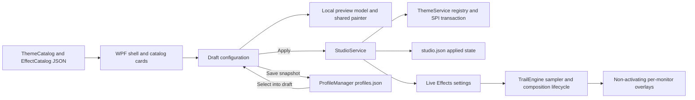

# CURSORIUM architecture

## v1.5 stability foundation

The target is now .NET 10/WPF/Win32; self-contained x64 distributions pin runtime
10.0.13. Frost executable names, namespaces, IPC, registry keys and user data paths
remain compatible. v1.4/.NET 8 tags are reproducible rollback baselines.

Idle sampling backs off to 80 ms with immediate Raw Input wake-up; active history
expiry and physical coordinates are unchanged. Session changes clear transient
effects and force environment re-evaluation. Display rebuild detaches the old render
subscription before releasing input and overlays. Raw input disposal is idempotent.
Settings cloning uses a typed copy, and painters retain coordinate/brush/pen delegates.
Paint count/ticks expose CPU drawing diagnostics, never GPU presentation claims.

New v1-compatible transaction journals include optional Intended registry values and
the previous ownership record. Recovery accepts per-entry Before/Intended values;
unknown external edits stop recovery with all evidence retained. `theme-ownership.json`
records the last successful native selection. Automatic restore refuses subsequent
external edits; legacy backups use managed-path checks. Legacy journals without
Intended retain the old protocol. Recovery validates non-empty original role paths
before writing. Immutable resources must match source SHA256 even when valid CUR files
already exist. IsActive is read-only and no longer prepares/copies native resources.

USER32 still rejects >=260-character cursor paths on the observed Windows build.
Long source CUR/ANI files use bounded, immediately deleted validation copies; WPF
preview opens a Stream. System installation never refers to those temporary copies:
overlong immutable native targets fail before any registry write. Native roundtrip
data roots are separate from descriptive report directories, and explicit tests cover
both successful long-source preview and rejected long permanent targets.

Profile and applied-state writers reject stale external file changes; future schemas
are preserved. A failed applied-state commit still rolls native values back through
ThemeService. Diagnostic roots reject real user data and linked roots.

The installer recognizes both slash forms of ZIP directory entries (.NET 10 behavior),
guards linked program trees before replacement/removal and recovers a marked `.previous`
directory when interruption left the main directory absent. This is not a complete
power-loss transaction for shortcuts/registration. Build staging is reset inside the
verified artifacts output to avoid carrying old runtime files; distribution manifests
contain relative file sizes/hashes. Future Steam boundaries and unverified scenarios
are documented in [the compatibility matrix](CURSORIUM-v1.5-COMPATIBILITY.md).

The original assemblies and namespaces remain `Frost.*`. This preserves installer, IPC,
backup and published executable compatibility while the product becomes CURSORIUM.
No new runtime dependency or UI framework was added.



## Services

| Module | Responsibility |
|---|---|
| `CursorTheme`, `ThemeCatalog` | Stable ID/name/author/description/preview/15 role mappings; directory discovery; path validation and safe file import. Invalid themes are skipped with a visible warning. |
| `CursorResource` | CUR directory/image bounds, hotspot checks, ANI RIFF/chunk/frame checks, size/frame limits, then native Windows loading. Only CUR/ANI are copied. |
| `ThemeService` | Immutable resources indexed by content hash; current-user registry values, named schemes, `SPI_SETCURSORS`, original backup, per-operation rollback and restart journal recovery. |
| `Settings`, `EffectCatalog` | Bounded numeric settings, four catalog presets, legacy preset migration and defensive deep copies. |
| `TrailModel` | Physical history capped at 256 samples, arc-length trimming, teleport separation, time-based expiry, at most eight click events. |
| `TrailEngine` | Shared Raw Input and physical sampling, one composition lifecycle, one transparent overlay per monitor, DPI conversion, fullscreen/default-input-desktop checks, tray pause. |
| `ClickEffectManager`, `ClickEffectPainter` | Independent Off/Halo/Ring lifecycle and drawing; button-down identity is retained. Left clicks draw one ring, right clicks two. |
| `StudioService` | Validates a draft; coordinates native transaction with applied JSON persistence; replaces live effects only on success. Controls persistent tray enable state. |
| `ProfileManager` | Atomic Create/Save/Rename/Delete; saved profiles own cloned configurations and survive a new process. |
| `MainWindow`, `LivePreview` | Three-column navigation/content/parameters; all controls connect to services. Preview owns a local model, runs only while visible with content, and never writes system state. |

## State boundaries

`MainWindow.Draft` is a deep copy of `StudioState.Applied`. Parameter and preset changes
modify that copy and the local preview. Saving a profile writes a separate snapshot;
it does not apply the draft. Selecting a profile copies it into the draft; Apply is
still required. Cancel copies the successfully applied state back into the draft.
Closing/reopening the panel retains the in-memory draft; restarting restores only
the successful applied state. A tray enable action updates the applied master switch
without discarding other draft edits. Tray pause is intentionally session-local.

The desktop renderer excludes the visible preview rectangle, including scroll clipping,
so an applied desktop effect does not appear over the draft preview. Outside that
rectangle it continues to use the successfully applied configuration.

On startup, Windows' installed cursor resources already persist independently of the
process. The app loads its saved effect configuration, recovers an interrupted transaction,
and does not silently reinstall a theme over a manually selected external Windows scheme.
If saved theme resources are missing, the original state is retained and a visible message
requires another selection/import before applying. Unknown state/profile schemas are
preserved and reported rather than overwritten with defaults.

## Native transaction

1. Validate/copy resources to an immutable `Theme/installed/<id>/<SHA256>/` directory.
2. Acquire the original current-user theme mutex. Recover any retained transaction.
3. Snapshot all affected cursor values (including existence and registry types), the
   original FROST scheme, and relevant CURSORIUM scheme entries. Atomically write and
   flush `theme-transaction.json` with previous registry, backup and applied-state text.
4. Create the original backup once; extend it with the pre-existing value of any newly
   introduced named scheme. Later switches retain the first original cursor values.
5. Write all roles and selected scheme, flush HKCU, reload with `SPI_SETCURSORS`.
6. Atomically save the new applied configuration. Delete the transaction to commit.
7. On any failure, restore registry values/types/absence, original-backup text and
   previous applied JSON. If rollback fails, retain the journal and report recovery failure.
   The next startup attempts the same recovery before constructing the UI.

Restoration uses the same transaction, archives the original backup and records the
system cursor selection while retaining effect parameters. Uninstall and the standalone
restore command also update a readable applied state. Uninstall aborts on failure.
Stable installed resources are deliberately retained because Windows can still refer
to them after an application exits or a portable folder moves.

JSON writes use a unique temporary file, flush it to disk and rename it in the same
directory. The registry is not a filesystem transaction; the durable journal bridges
partial failure and interrupted execution. External edits occurring during a transaction
cannot be isolated by Windows; operations are short and serial within this app.

## Theme schema example

```json
{
  "SchemaVersion": 1,
  "Id": "my-theme",
  "Name": "My Theme",
  "Author": "Local artist",
  "Description": "A native pointer suite",
  "Preview": "preview/Normal.png",
  "Roles": {
    "Normal": "Normal.cur",
    "Help": "Help.cur",
    "Working": "Working.ani",
    "Busy": "Busy.ani",
    "Precision": "Precision.cur",
    "Text": "Text.cur",
    "Handwriting": "Handwriting.cur",
    "Unavailable": "Unavailable.cur",
    "Vertical": "Vertical.cur",
    "Horizontal": "Horizontal.cur",
    "DiagonalNWSE": "DiagonalNWSE.cur",
    "DiagonalNESW": "DiagonalNESW.cur",
    "Move": "Move.cur",
    "Alternate": "Alternate.cur",
    "Link": "Link.cur"
  }
}
```

IDs use lowercase letters/digits/hyphens, are unique and remain stable across restarts.
Absolute paths, escaping paths and reparse-point resources are rejected. No package
code is loaded. Single-file import inherits missing roles from the selected local
theme (FROST when Original system is selected); multi-file import matches role filenames.
External Windows schemes remain recoverable in the backup; the library currently lists
the bundled and imported themes, rather than enumerating every Windows scheme.

## Input, rendering and resources

Keep `RIDEV_INPUTSINK`, omit `RIDEV_NOLEGACY`, and leave input messages unconsumed.
Overlays retain layered/transparent/no-activate/tool-window styles plus transparent hit
testing. Coordinates remain global physical pixels until each painter converts to DIPs.
Display rebuild and power callbacks marshal to the WPF dispatcher. Fullscreen detection
uses the existing non-shell foreground-window bounds heuristic; unavailable input
desktops pause/clear effects. There is no process injection or input remapping.

Rendering attaches only with pending content and detaches after expiry. Disabled effects
sample at about 4 Hz and hide overlays; pause lowers sampling and hides them. Frozen pens
and brushes are cached and quantized, particle drawings are capped at 24, and click events
at eight. Stardust drift/fade uses elapsed time, sharing the same sampled movement history.
120/60/30 are scheduling targets, not guarantees of GPU presentation.

Owned validation handles use `LoadImage` without `LR_SHARED`, then `DestroyCursor`.
Shared system `LoadCursor` handles and WPF system cursor singletons are not destroyed.
Custom WPF cursors are detached from controls before disposal. Exit releases Raw Input,
render subscriptions, display/power subscriptions, overlays, timers, tray/menu/icon and IPC.

Native API behavior was checked against Microsoft's [DestroyCursor documentation](https://learn.microsoft.com/en-us/windows/win32/api/winuser/nf-winuser-destroycursor),
[LoadCursorFromFile documentation](https://learn.microsoft.com/en-us/windows/win32/api/winuser/nf-winuser-loadcursorfromfilew) and
[Raw Input registration documentation](https://learn.microsoft.com/en-us/windows/win32/api/winuser/ns-winuser-rawinputdevice).


## v1.1 presentation foundation

ResourceDictionary files under `Frost.App/Presentation` own design tokens, vector icons
and interactive templates. `StudioViewState` projects button availability, Draft/Applied,
current combination, Saved Profile identity and feedback. It neither persists application
configurations nor controls the native renderer. Existing event handlers still call the
same StudioService/ThemeService/ProfileManager boundaries.

`UiPreferences` writes `interface.json` (schemaVersion 1) separately from profiles and
applied state. Animation and system-caption choices take effect immediately. `UiMotion`
only animates card Transform and page Opacity, checks Windows ClientAreaAnimation,
and cancels unnecessary motion when disabled. It creates no background loop.

`WindowAppearance` uses WPF WindowChrome native hit testing and SystemCommands. The
normal window stays opaque; resize borders/caption integrate with Windows while closing
still hides to the existing tray. An explicit SingleBorderWindow fallback requests dark
DWM caption attributes; unsupported cosmetic attributes do not block window behavior.
DPI work-area fitting remains in DIPs derived from physical monitor work bounds.

Apply/Cancel share one projection: dirty configuration or changed Profile identity makes
a draft; invalid hex input disables Apply while allowing Cancel. Saving a Profile does
not apply it. Cancel restores both applied configuration and Profile ID before updating
controls. An open dropdown owns Escape before the global draft-cancel shortcut.

The central content scroll contains preview then catalog cards. Compact navigation keeps
icons/tooltips/automation names; settings tabs scroll independently of pinned Apply/Cancel.
Mix Studio and Settings prioritize their content instead of showing an unrelated preview.

Primary API references: [WindowChrome](https://learn.microsoft.com/en-us/dotnet/api/system.windows.shell.windowchrome),
[SystemParameters.ClientAreaAnimation](https://learn.microsoft.com/en-us/dotnet/api/system.windows.systemparameters.clientareaanimation),
[DWM attributes](https://learn.microsoft.com/en-us/windows/win32/api/dwmapi/ne-dwmapi-dwmwindowattribute).

## v1.2 theme library extension

SchemaVersion remains 1. CursorTheme optionally records SourceUrl, License,
Collection, IsAnimated, ImportedAt, PublishedAt, PackageSha256, SourceFiles
(original name/path/SHA256) and InheritedRoles (role to fallback theme ID).
ReadTheme still requires all 15 usable roles and validates source resources/hashes.
NativeRoleCount excludes inherited roles; extra files are provenance, not standard
roles. Built-in generation keeps the old manifest bytes using an explicit projection.

CursorPack only stages bounded ZIP/folder cursor bytes. EOCD count is bounded before
central-directory allocation; paths, links, expanded bytes and ratios are checked.
CursorRoleRecognition suggests roles from the leaf filename, never enumeration or
parent names. The WPF PackImportDialog reviews conflict/missing roles and fallback.
ThemeCatalog.Import validates a GUID staging directory then moves it atomically
into the same user Themes directory. No new theme service or package executable.

ThemeLibraryPreferences stores filter and favorite IDs in library.json, separate
from Draft, Applied, interface.json and Profile data. Cards project independent
selected/applied/modified states. Metadata/source links come from the catalog.

AniTimeline validates original seq/rate/jiffies. AnimatedCursorPreview decodes at
most 256 48x48 frozen images once via Windows native resource decoding, disposing
handles immediately. Its visible-only DispatcherTimer uses elapsed time and source
jiffies; functional animation is independent of optional UiMotion. The local input
cursor is still the original WPF Cursor, retaining native hotspots and animation.
ThemeService, StudioService and all desktop render/input lifecycles remain intact.

Installer isolation is opt-in under --isolated-test --test-install-root, restricted
to non-linked TEMP CursoriumUpgradeTest-* roots. It uses separate install/data/link
and registration names and never sends production IPC or changes the Run entry.
Production installation paths, startup behavior and restoration stay compatible.

In v1.2.1, CursorPack additionally scans each bounded central-directory header and
compares actual entries with EOCD before constructing ZipArchive. This closes the
understated-counter allocation gap; directory offsets, sizes and name lengths are
validated in the same preflight. Forged-directory regression measures allocation.

## v1.3 online discovery and local ownership

Explore is a DiscoverView hosted inside the original WindowChrome shell, spanning
the workspace columns. Cursors/Trails/Mix retain MainWindow's Draft projection,
local preview, parameter controls and pinned Apply/Cancel. Detail selection never
changes Draft; Open in Cursors/Trails explicitly selects an owned resource there.

RemoteCatalogService reads only the official public HTTPS index. It verifies exact
bytes using an embedded 3072-bit RSA-PSS public key, validates schema/metadata and
atomically caches bytes plus signature. Concurrent refreshes share a task; 15-second
catalog timeout falls back to the last verified cache. No GitHub token is shipped.
Version and renderer compatibility are separate from resource display names.

OfficialHttp streams bounded bytes asynchronously, checking every redirect against
the Pages/repository/CDN boundary. DownloadManager coordinates package hash/size,
CursorPack.OpenValidatedArchive and VerifiedResourcePack; it does not duplicate
the forged-central-directory parser and never invokes ThemeService. CUR/ANI binary
and native-load validation remains mandatory after signed-package verification.

Cursor packages contain schema1 theme.json, cursor files and NOTICE.txt. Resource
ID/version/name/author, role coverage and provenance must match signed catalog data.
The immutable user Themes/<id>/<package-sha>/ tree is fully validated before atomic
root manifest publication; the manifest is the installation record. Existing bundled
IDs are owned without another download. MotionLibrary/<id>.json is the independent
atomic record for data-only presets with four trusted renderer types and existing
numeric bounds. Profiles retain numeric settings, so removing a motion preset does
not remove saved behavior. Source downloads and Windows stable native copies have
independent lifetimes; safe removal never deletes Theme/installed.

Preview packages live in bounded process/start-time staging, not the owned library.
The real WPF Cursor retains hotspots/ANI timing; AnimatedCursorPreview shares the
existing seq/rate decoder for the visible hero. Leaving details clears frame
references and destroys owned handles/cursor before deleting staging. Dead-session
cleanup validates a bounded non-reparse tree and preserves active process sessions.

Explore uses 24-resource pages and at most four asynchronous PNG loads, never a
per-card ANI timer. Covers are generated from native cursors or production
TrailPainter output; the disk media cache is bounded at 24 MiB and decode at 512px.
library.json remains the shared favorite-ID source for online and local resources,
including favorites temporarily absent from an offline catalog. Online state,
owned resources, Draft and Applied are distinct projections of the same IDs.

The independent cursorium-library repository publishes signed catalog v1 JSON,
actual media, attribution and immutable Release ZIPs. Schema is documented in
docs/catalog-v1.schema.json; adding reviewed compatible data needs a catalog update,
not a desktop release. New executable renderers cannot be supplied by downloads.

## v1.3.1 presentation refinement

ThemeCoverRenderer is a static presentation helper shared by owned-theme cards
and the offline media exporter. It reads validated original cursor frames (ANI
sequence's initial frame at native size) and uses integer pixel enlargement.
Trail covers call the existing TrailModel/TrailPainter with unchanged preset
parameters and a deterministic simulated gesture; no new renderer is installed.
The media-only generator never applies themes or recreates immutable packages.

Discover retains 24-card paging, four media requests, signed catalog access and
DownloadManager coordination. Card geometry uses the actual viewport. Frozen
PNG decoding is shared by URL, capped at 24 entries/40 MiB, never upscales source
images, and keeps the existing 24 MiB disk bound. Versioned cover URLs refresh
media independently of resource version/hash, so owned themes need no download.

Detail hero separates Overview/actions from collapsed Technical Details. Temporary
verified previews retain original WPF cursors/hotspots and ANI timing. Observation
zoom changes only Image layout, while role gallery buttons select the existing
preview role; neither changes Draft or system state. Leaving details cancels its
media, disposes preview resources, and clears scoped messages. Genuine background
downloads keep their own progress feedback. Local cards keep Draft/Applied state
projection and ownership separate. System recovery stays confirmed and accessible
inside an expander; Apply/Cancel semantics and Profile data remain unchanged.

Native services, safety parsers, downloader/catalog protocols and global desktop
rendering are unchanged. The original physical preview exclusion remains; the
application does not suppress applied desktop trails across its whole window.

## v1.4 — curation, collections and immutable updates

RemoteCollectionsService consumes a separate, strict, bounded JSON document and
detached signature through OfficialHttp and RemoteCatalogService.VerifySignature.
The catalog v1 Resources contract is unchanged. Collections validate member IDs
against the verified catalog, cap count/size, reject rollback and unknown cache
schemas, coalesce refreshes and retain a verified offline cache. Explore searches
name, author, description, tags and collection names locally; Installed and Not
Installed are ownership filters, independent of Draft/Applied/favorites. The
existing 24-resource pagination, static covers and bounded media caches remain.

LibraryPublisher's reviewed batch preparation reuses CursorPack, CursorResource,
ThemeCatalog.ReadTheme, VerifiedResourcePack, ThemeCoverRenderer and TrailPainter.
It checks original hashes, explicit filename mappings, author/license decisions,
identity/version conflicts and duplicate source/package content before signing
exact bytes with the protected existing key. Publication preflights packages and
prepared media, publishes immutable Release assets, verifies public downloads,
then fast-forwards Pages main. A metadata-only mode validates unchanged package
identities/hashes and publishes tags/collections without an empty resource Release.
See CURSORIUM-LIBRARY-WORKFLOW.md for the reusable workflow and failure behavior.

DownloadManager rejects same-version package replacement, downgrade and author
conflicts. Updates retain previous SHA directories; download never changes Windows.
StudioConfiguration adds an optional CursorPackageSha256 pin without changing
SchemaVersion 1. StudioService.ResolveTheme resolves retained, validated manifests
inside the managed theme root; it does not replace native transactions. Legacy
applied pins are inferred in memory from actual native state without rewriting
existing Profile files. MainWindow previews the pinned version, offers an explicit
installed-update action, and Cancel restores the applied pin. Applying only motion
keeps old cursor resources. The original ThemeService backup/SPI transaction remains
the sole Windows application path. Pins in saved Profiles prevent implicit updates.

Verification captures rasterize the running, bound WPF window visual tree at its
actual DPI. This avoids stale/occluding BitBlt content and private desktop leakage.
It is real application rendering, not a concept image, but is not evidence of an
unobstructed desktop screenshot or physical multi-DPI display switching. Native
window/input tests remain separate.
