# CURSORIUM v1.1 运行截图

以下全部是运行中的 WPF 原生窗口截图；并非设计图或静态 UI 原型。主页面与对照图均为 **1280×830 native pixels / 96 DPI**。
窗口背景使用低对比网格，光效来自真实鼠标移动；截图无全局 Apply 操作，使用隔离的 Daily Focus 测试 Profile。

## 同尺寸前后对照

| v1.0 基线 | v1.1 实际窗口 |
|---|---|
| 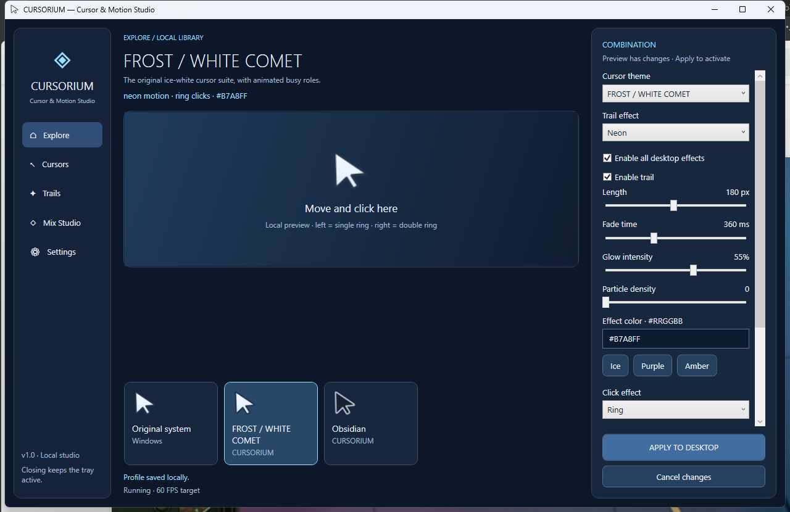 | 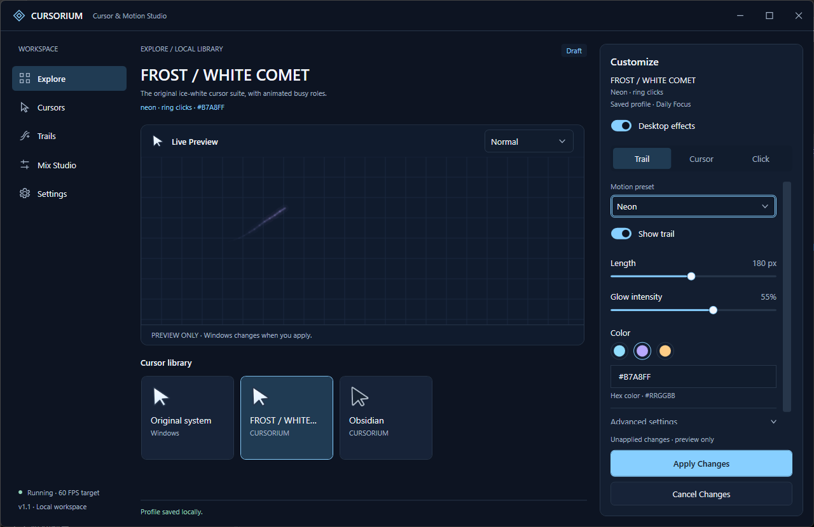 |

[横向截图图库](images/v1.1/gallery.html) 可在浏览器中查看等宽并排对照、全部页面与九组布局。

## 主界面与主要页面

### Explore

### Cursors

### Trails

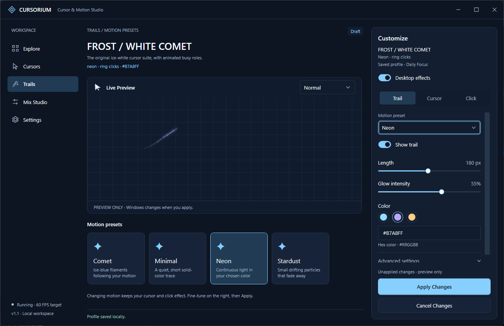

### Mix Studio

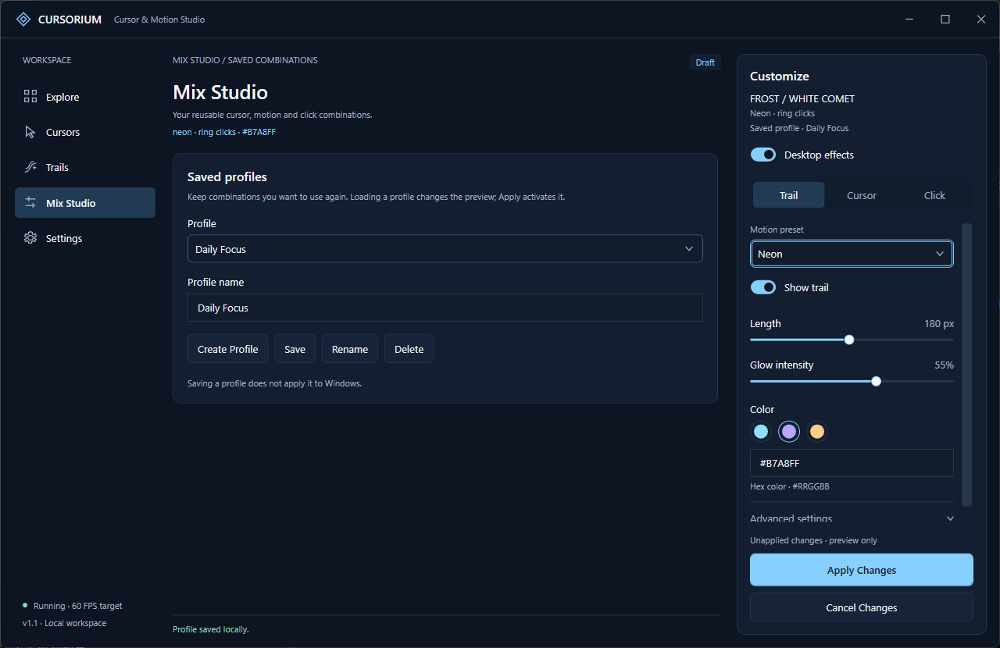

### Settings

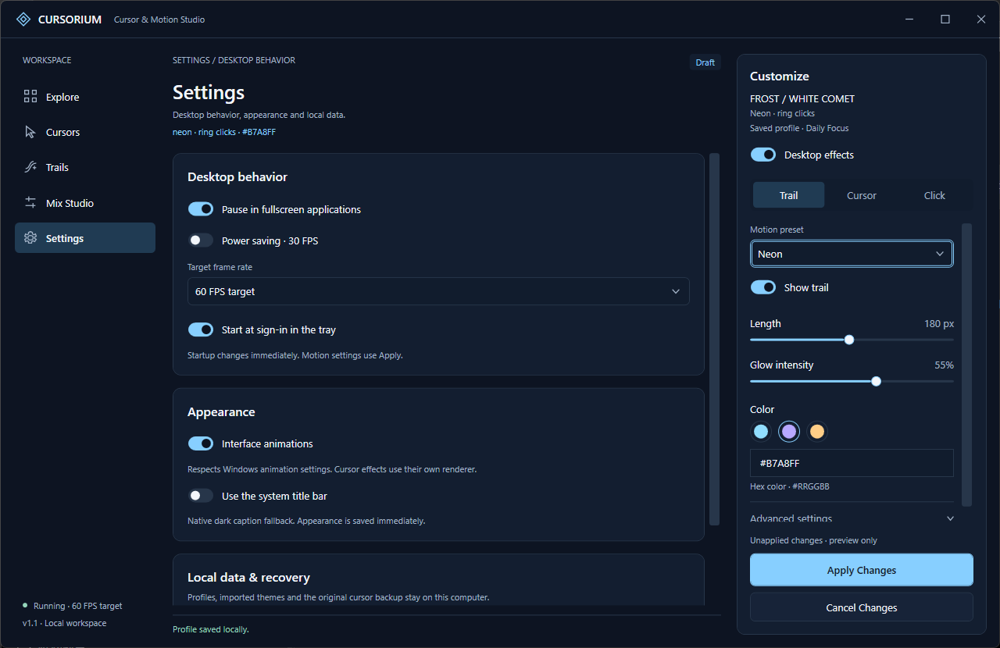

## 配置视图与窗口回退

### Trail

### Cursor / System recovery

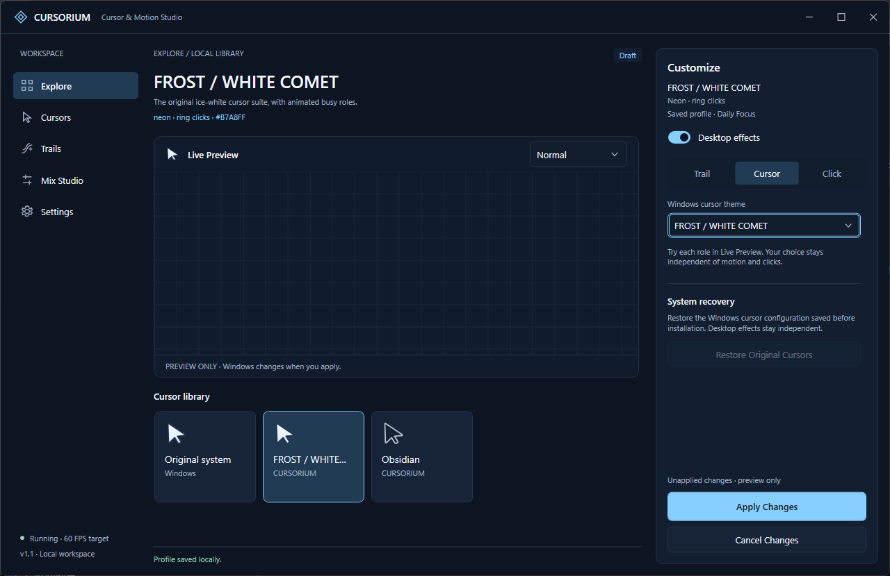

### Click

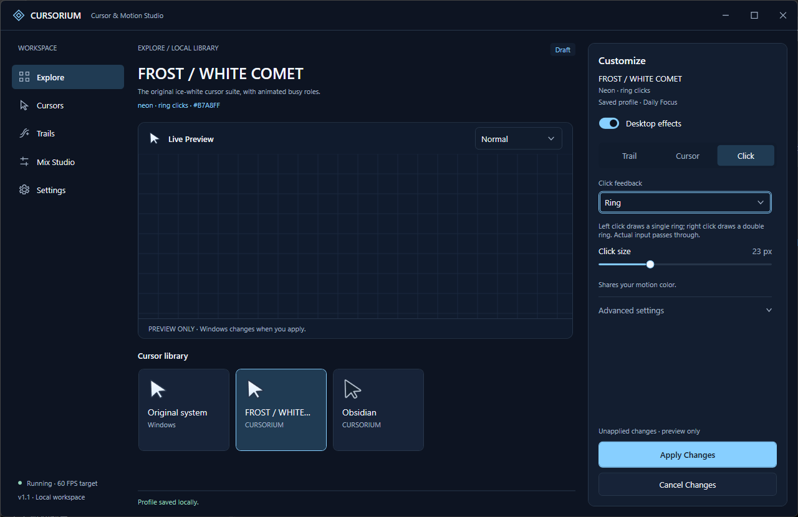

### Advanced settings

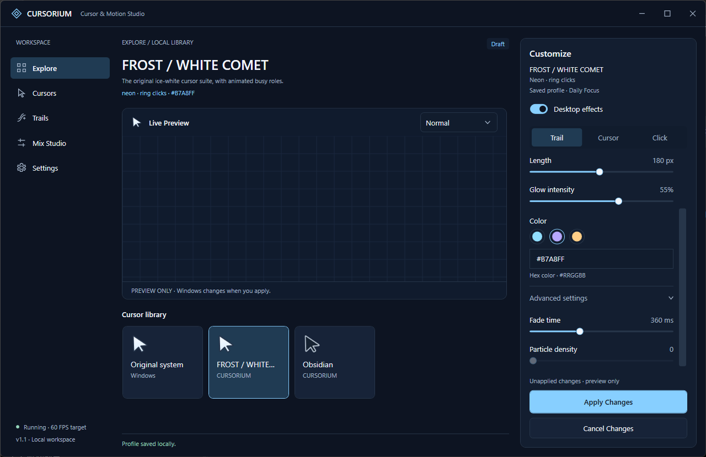

### Native system title bar

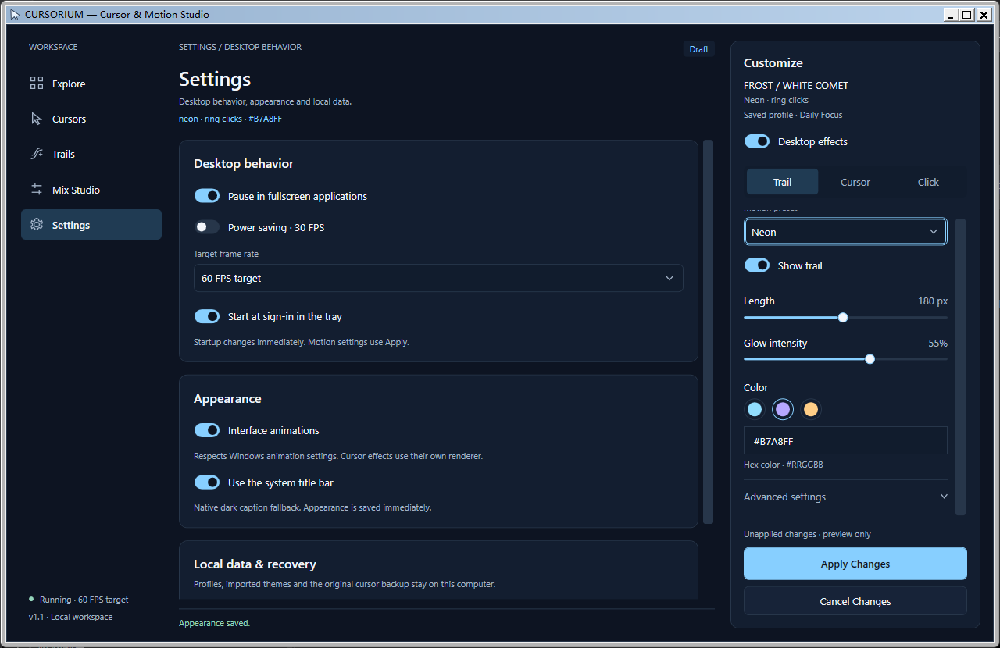

### 850×520 DIP compact window

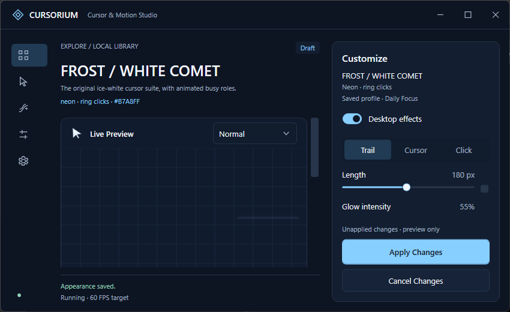

### 长名称紧凑布局

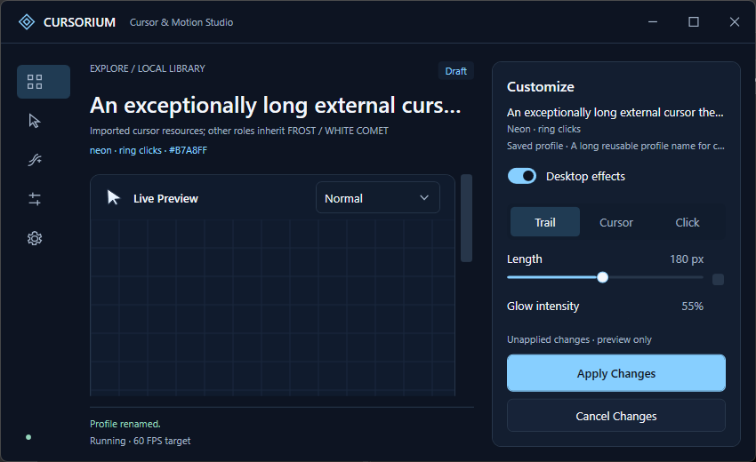

## 布局矩阵

这些图片使用等效 DIP 工作区尺寸模拟分辨率/缩放带来的空间变化。实际显示器仍为 96 DPI，**不能视为物理 125%/150% DPI 验证**。

| 屏幕尺寸 | 100% equivalent | 125% equivalent | 150% equivalent |
|---|---|---|---|
| 1366x768 | [查看](images/v1.1/layout-1366x768-100-logical.png) | [查看](images/v1.1/layout-1366x768-125-logical.png) | [查看](images/v1.1/layout-1366x768-150-logical.png) |
| 1920x1080 | [查看](images/v1.1/layout-1920x1080-100-logical.png) | [查看](images/v1.1/layout-1920x1080-125-logical.png) | [查看](images/v1.1/layout-1920x1080-150-logical.png) |
| 2560x1440 | [查看](images/v1.1/layout-2560x1440-100-logical.png) | [查看](images/v1.1/layout-2560x1440-125-logical.png) | [查看](images/v1.1/layout-2560x1440-150-logical.png) |
