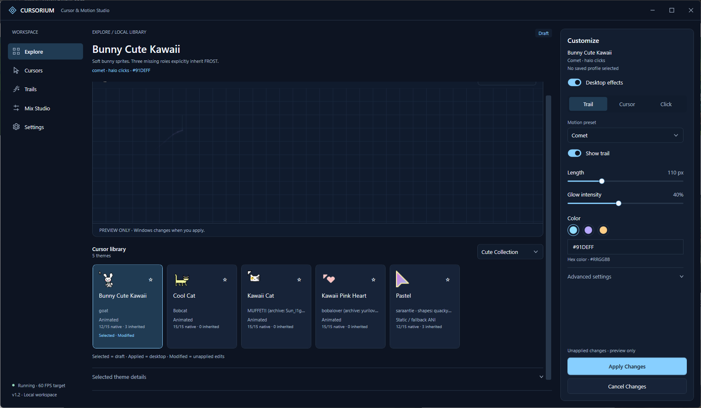
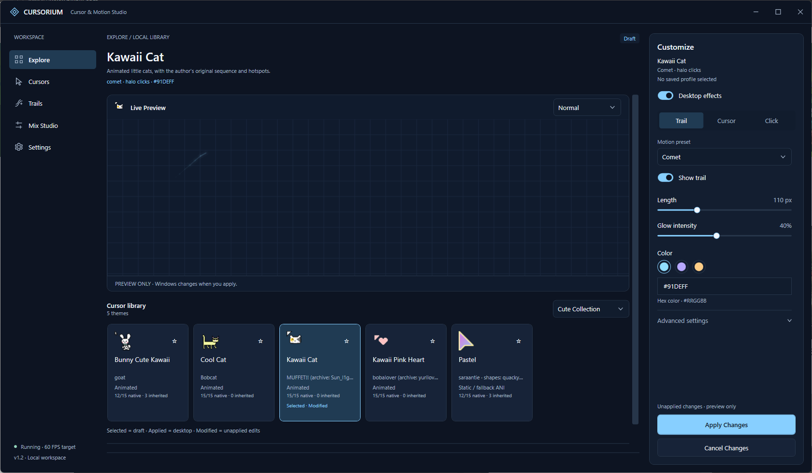
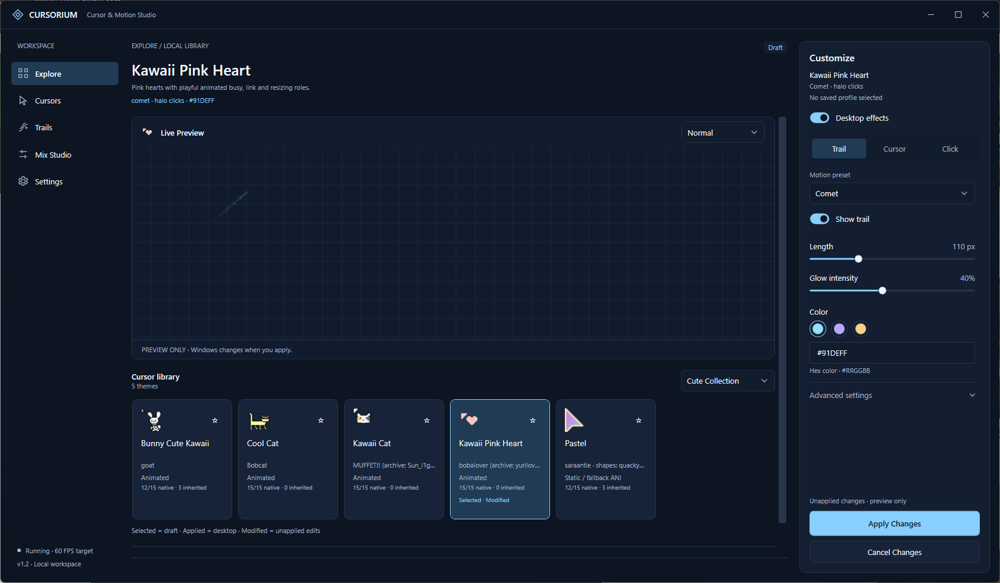
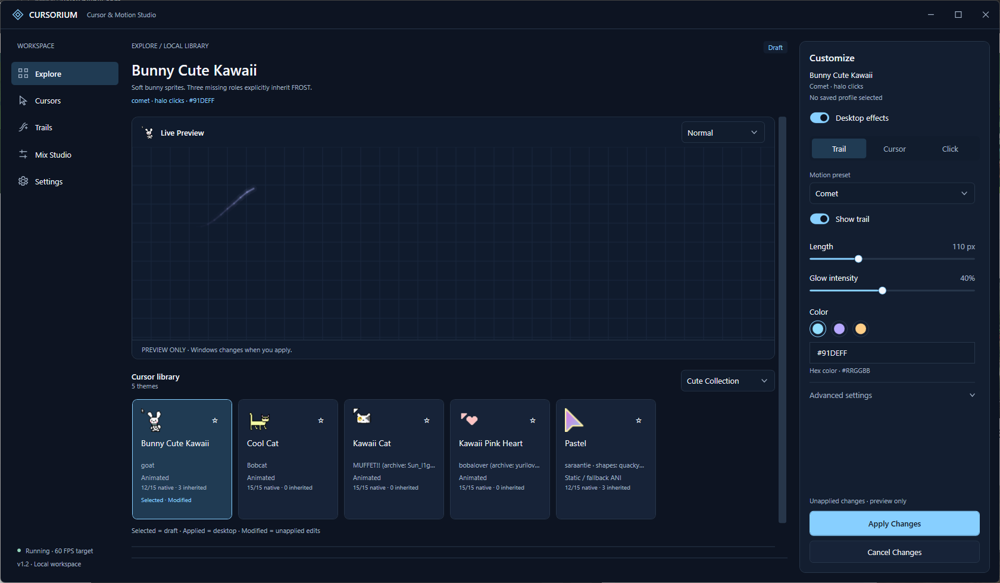
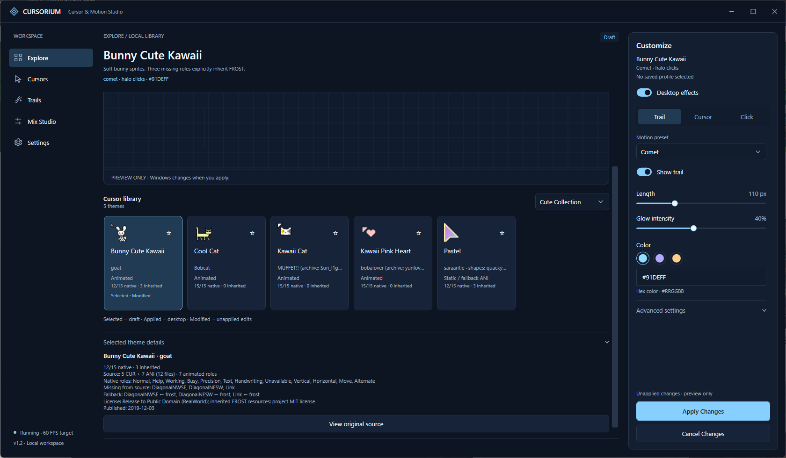
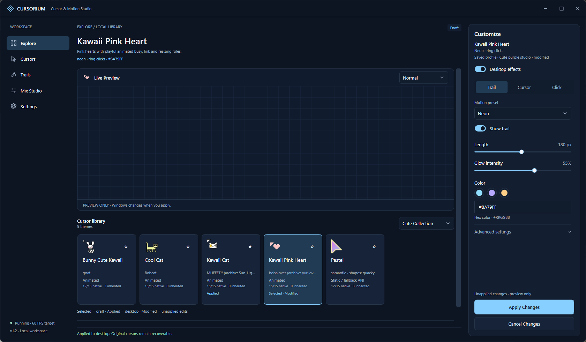
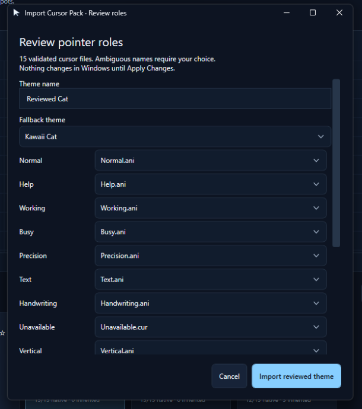
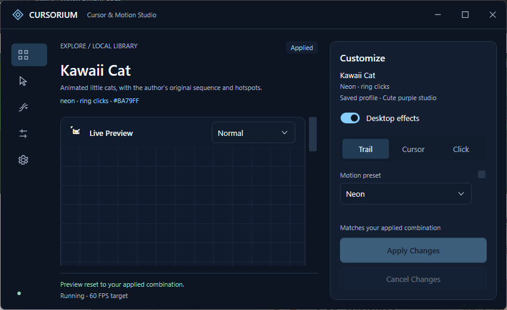

# CURSORIUM v1.2.0 实际运行截图

全部来自运行中的 WPF native window 屏幕捕获，使用隔离数据和真实鼠标移动。
主截图为 1680×980 native pixels / 96 DPI；小窗口 850×520；Import review 为实际独立 WPF 窗口。
测试期间只在验证 Apply 时改变系统配置，结束后恢复；示例 Profile 没有写入用户目录。
大屏列表图为内容流滚动后的视口，预览标题可能已滚出视口，固定 Apply/Cancel 保持可达。

## Cute Collection

## 主题预览

| Kawaii Cat | Kawaii Pink Heart |
|---|---|
|  |  |

光标资源与运动预览实际运行。屏幕捕获不叠加系统鼠标指针，卡片与预览栏显示真实资源图像；动画和实际移动另外通过专项检查验证。

## 来源、角色和回退详情

## Applied 与 Selected

Cat 已通过 Windows 原生事务应用，Pink 仅为草稿。Cancel 验证恢复 Cat、对应 Profile 与全部参数。

## 包导入映射与小窗口

v1.1 的 WindowChrome、三栏与设计系统保留；本次没有整套主窗口重设计。
