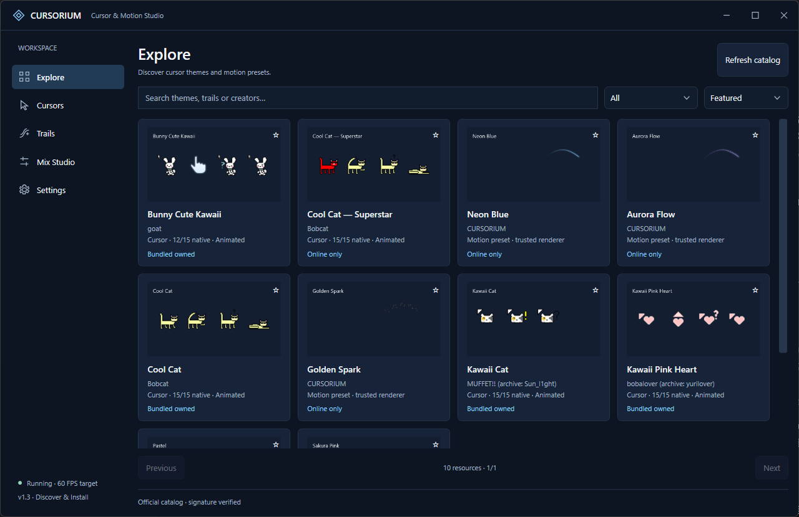

# CURSORIUM v1.3.0 — Discover & Install 中文交付记录

本轮保留 .NET 8 / WPF / Win32、WindowChrome 与 v1.1 设计 Token，在现有主题、渲染、Profile 和原生事务之上完成在线发现及安全安装。基线 main `3546c571726cdb86ade3f2a74e98009d2e59a6dd`，开发分支 `codex/discover-v1.3`；v1.2.1 与此前 tag/Release 不移动。修改前保存安装 ZIP、用户数据副本、文件 SHA256、指针值与快捷方式，资料仅位于忽略的本机 artifacts。

## 实际功能

| 模块 | 结果 |
|---|---|
| Explore | 完成：公开 HTTPS 签名目录、真实静态封面、搜索、元数据分类、Featured / Recently added / Name 排序、收藏、分页、刷新及离线缓存 |
| 内部详情 | 完成：Back、作者、版本、授权、来源、真实包大小/哈希、角色及回退信息、状态与操作；没有新增独立详情窗口 |
| 两级预览 | 完成：先显示真实资源生成的 PNG；Try Live Preview 按需下载到临时目录，经 SHA256、ZIP 与原生验证后加载实际 CUR/ANI 或可信拖尾模型 |
| 下载 | 完成：实际字节进度、取消、120 秒请求超时、最多一次传输重试、重复任务保护、兼容性、SHA256、数据包校验、原子提交、失败清理与死进程暂存恢复 |
| Cursors | 完成：仅本地拥有主题；原系统、FROST、Obsidian、五套 Cute 无重复迁移；下载主题、导入、15 角色、ANI、草稿/应用状态、受引用保护的移除、Explore 入口 |
| Trails | 完成：原四种算法和下载参数预设共用现有 LivePreview / TrailPainter；参数、颜色、Advanced、Apply / Cancel、移除与 Explore 入口 |
| Mix / Settings | 保留 Profile 和偏好、托盘、启动、快捷键；Settings 说明在线缓存与本地数据位置 |
| 用户数据 | 原五个配置文件不改 schema；在线缓存独立保存，收藏继续使用同一 library.json ID 集合；新主题安装记录是原子 theme.json，拖尾是独立 MotionLibrary JSON |

收藏、临时预览、下载、草稿和已应用状态分别表达。下载和预览没有调用 Windows Apply；只有原来的 StudioService / ThemeService 事务可以改变系统。Cursors 选择不会重置拖尾；下载拖尾保存的是既有 renderer 与数值，Profile 不依赖预设文件继续存在。

## 云端架构和内容

- 资源仓库：[catvir4493/cursorium-library](https://github.com/catvir4493/cursorium-library)
- 目录：[catalog/v1/index.json](https://catvir4493.github.io/cursorium-library/catalog/v1/index.json)
- 签名：[index.json.sig](https://catvir4493.github.io/cursorium-library/catalog/v1/index.json.sig)
- JSON Schema：[schema.json](https://catvir4493.github.io/cursorium-library/catalog/v1/schema.json)，源码副本 [catalog-v1.schema.json](catalog-v1.schema.json)。运行时还检查唯一 ID、角色子集、URL、版本、包身份及原生资源。
- 真实资源包：[Library v1.0.0 Release](https://github.com/catvir4493/cursorium-library/releases/tag/library-v1.0.0)。10 个 ZIP 与 SHA256SUMS；资源 Release 不与桌面版本捆绑。
- 客户端访问无需账户或 Token。GitHub Pages 提供 JSON / PNG，GitHub Releases 提供 ZIP，官方重定向到 GitHub release-assets CDN。

| 资源 | 作者 | 类型 | 原生角色 / 回退 | 动态角色 | 授权 |
|---|---|---|---|---|---|
| Kawaii Cat | MUFFET!!，归档 Sun_l1ght | Cursor | 15 / 0 | 14 | Public Domain |
| Kawaii Pink Heart | bobalover，归档 yurilover | Cursor | 15 / 0 | 10 | Public Domain |
| Bunny Cute Kawaii | goat | Cursor | 12 / 3 | 7 | Public Domain；回退 FROST MIT |
| Pastel | saraantie，原文署名 quackyduck 部分形状 | Cursor | 12 / 3 | 1（回退 ANI） | Public Domain；回退 FROST MIT |
| Cool Cat | Bobcat | Cursor | 15 / 0 | 15 | Public Domain |
| Cool Cat — Superstar | Bobcat；CURSORIUM 映射变体 | Cursor | 15 / 0 | 15 | Public Domain |
| Neon Blue | CURSORIUM | Neon 参数 | 不适用 | 不适用 | MIT |
| Sakura Pink | CURSORIUM | Neon 参数 | 不适用 | 不适用 | MIT |
| Aurora Flow | CURSORIUM | Comet 参数 | 不适用 | 不适用 | MIT |
| Golden Spark | CURSORIUM | Stardust 参数 | 不适用 | 不适用 | MIT |

五套作者来源页及 ZIP 本轮重新获取，原始 ZIP 哈希分别为：Kawaii Cat `92febf3cfdaecf0eb2220c15e8b27a4e297d44e0a9237f71c15ca25a2fca6055`；Pink Heart `6ecca8bc3c7ef461efab20dd12c847a4a9308a4ef39c4ab880c25665bbf3f34c`；Bunny `64828ebf68e212801eaa0fa03a81c8e519ee63da8e201c7fb4423176436ffdc5`；Pastel `b002f0b58ebb627d054a94a152917f7659adc64d336e92378e6bb2c712acb1cb`；Cool Cat `bfc999d1b574e6ae4c079d2868df699aebb9f763e271facb0ae6f18ecadfc8a7`。来源、逐文件哈希、角色表沿用并复核 [v1.2-SOURCES](CURSORIUM-v1.2-SOURCES.md)。每个发布包自带 NOTICE.txt。

Superstar 并非伪造的第六套作者主题：明确取 Bobcat 原包的 `Cool Cat i'm a superstar.ani` 替换 Normal，其他角色与原包资源保留，不改动画时间或热点。该在线独有变体提供了真实 Cursor 下载和 Apply 验收路径。原五套继续被识别为 Bundled owned，无需下载。

## 信任与安全边界

目录原始字节由 3072-bit RSA-PSS / SHA256 签名，客户端程序集固定 SPKI 公钥。修改 JSON 或错误签名无法进入缓存。私钥留在仓库之外的本机发布目录，权限限制当前用户，未放入应用、源码、GitHub 或任何 Release。缓存保持签名与原始字节；较旧目录不能覆盖已知较新缓存。

仅允许官方 Pages 路径、指定 library 仓库 Release 路径，及从该 Release 跳转的 GitHub 资产 CDN。每次跳转重新检查，最多三次；拒绝 HTTP、凭据 URL、其他仓库、其他站点。包必须匹配签名目录的字节数和 SHA256。签名密钥被盗仍可授权恶意数据，签名不是安全文件的证明；所有 ZIP、CUR、ANI、原生加载和字段验证仍执行。没有目录透明日志、到期服务或自动换钥；首次安装的防重放范围与固定公钥轮换限制保留。

复用 CursorPack 的 v1.2.1 中央目录预扫描，进一步共用路径、重解析属性、重复名称、256 项、128 光标、32 MiB 单文件、64 MiB 总量及 200:1 压缩比边界。下载包只接受 CUR / ANI、规定 JSON 与 NOTICE.txt；EXE、DLL、INF、脚本和其他文件拒绝，未执行任何第三方代码。主题 JSON 的 15 个角色、作者源文件哈希和签名目录身份重新核对。

Cursor 安装使用 `Themes/<id>/<package-sha>/` 不可变内容和根部原子 manifest；原系统应用仍复制到 `Theme/installed/<id>/<hash>/`。移除检查当前 Applied、Profile、注册表及原备份；永不删除稳定原生副本。崩溃暂存按进程 PID 和启动时间分会话，下一次启动回收死亡会话、保留仍运行的会话。未知/较新 schema 文件保留，不静默覆盖。

## 测试证据和性能

源码 Release 构建：0 错误、0 警告。以下均为本轮重新执行，详情在 [validation/v1.3](validation/v1.3)：

| 检查 | 通过数 | 证据 |
|---|---:|---|
| 原核心与原生事务 | 180 | core-report.json |
| 原桌面与输入 | 85 | desktop-report.json |
| 界面 | 98 | interface-report.json |
| Cute 集合 | 28 | collection-report.json |
| 在线安全故障注入 | 51 | online-security-report.json |
| 公开网络与真实 WPF | 51 | discover-report.json |

旧 Explore 本地预览检查按产品职责迁移到 Cursors；Explore 改验真实发现区，内部详情的 CUR/ANI 交互另由在线专项验证。未删除安全回归或弱化 Apply、Cancel、角色、窗口、DPI 逻辑布局断言。原始 180 项继续包含伪造 EOCD / 实际中央目录数量和分配上限检查。

在线专项实际使用公开 Pages 与 Release：验证签名、10 项内容、五套无需重复下载、搜索/分类、在线收藏、15 角色 ANI 临时预览、真实取消按钮、实际下载、重复安装、进入 Cursors、Windows Apply、Profile、依赖保护、Cancel、拖尾下载与独立 Apply、服务重启和原生恢复。全部使用隔离数据目录，finally 再核对并恢复原指针快照。

100 / 300 / 500 资源的明确标记模拟目录均创建 24 张卡片；本轮测得布局约 26.45 / 24.71 / 25.48 ms，托管增量约 3.02 MiB，USER 增量 0。仅为短时实机测量，非数百项真实在线资源的长期压测。卡片为静态 PNG，没有后台 ANI；详情只保留一个功能性动画预览，隐藏/离开释放原生 Cursor、帧引用及临时包。媒体并发 4、PNG 最大 1 MiB / 2048×2048、解码宽 512、磁盘缓存 24 MiB。

30 次真实 Cute 切换后 GDI 171→157、USER 102→83，没有增长泄漏迹象。8 种原引擎短时基准每种约 4 秒；关闭模式无绘制失效，全机 CPU 约 0.10%，静止模式约 0.15%；具体模式数据见 performance-report.json，不等同长期稳定性保证。

## 显示、安装及限制

本轮实际枚举单屏 Windows 11、2560×1440、96 DPI。实际运行正常窗口、小窗口与最大化；1920×1080、1366×768、125%/150% 使用等效逻辑工作区检查，不能当作物理 DPI 或显示器切换。当前没有双屏，未声称重新实测双屏。Windows 10、混合 DPI、长期压力、受保护桌面、独占游戏和完整安装/卸载/失败回滚矩阵仍待实测。

安装升级继续使用已有 build-release / verify-release / publish-github 流程。真实 D 盘升级首轮发现 C 盘 TEMP 跨卷目录移动失败，安装器已回滚到 v1.2.1。现已改为目标目录同卷、带归属标记的暂存目录；补充在 D 盘隔离副本、C 盘 Windows TEMP 的升级验证，61 个用户数据文件、750 个安装文件及真实指针状态通过核对。见 upgrade-cross-volume-report.json。目标沿用注册安装路径 `D:\CURSORIUM`，用户数据仍为 `%LOCALAPPDATA%\FrostWhiteComet`。升级的最终实测数据、包校验和远程发布记录以 Release 及本机 artifacts 的最终验证资料为准；没有将任何安装备份或用户配置混入公开证据。

## 文件与以后增加资源

主要 UI 文件：MainWindow.xaml / .xaml.cs、Presentation/DiscoverView.xaml / .xaml.cs；复用 DesignTokens.xaml、Controls.xaml、Icons.xaml、UiMotion、StudioViewState、LivePreview 和 AnimatedCursorPreview。核心新增 Online/RemoteCatalog.cs、Online/DownloadManager.cs；CursorPack 抽出共享预扫描入口，CursorTheme 和 TrailPreset 只增加可选元数据。ThemeService、StudioService、原渲染及输入代码没有重写。

手工增加主题：核查再分发权利 → 安全校验原始文件和角色 → 保留 NOTICE / 来源 → 形成 schema1 theme.json 或白名单 preset.json → 制作实际资源 PNG → 发布新的不可变 library Release → 计算真实尺寸/哈希 → 编辑目录稳定 ID/版本/兼容字段，增加 CatalogVersion → 用保护私钥签名原始 JSON 字节 → 提交推送并核验 Pages。签名字节禁止 Git 换行转换，library `.gitattributes` 对 catalog 使用 `-text`。不需要重发桌面软件，只要兼容既有引擎；新算法不能由远程代码加载。

其余真实界面、搜索、详情、ANI、下载、已安装、Cursors、Trails 和紧凑窗口见 [截图记录](CURSORIUM-v1.3-SCREENSHOTS.md)。
