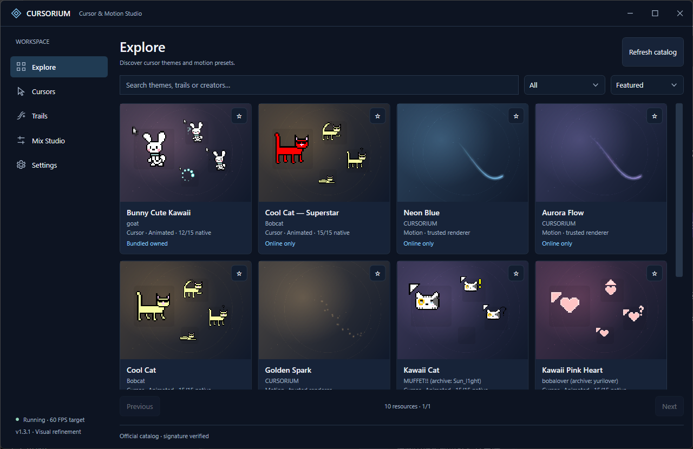
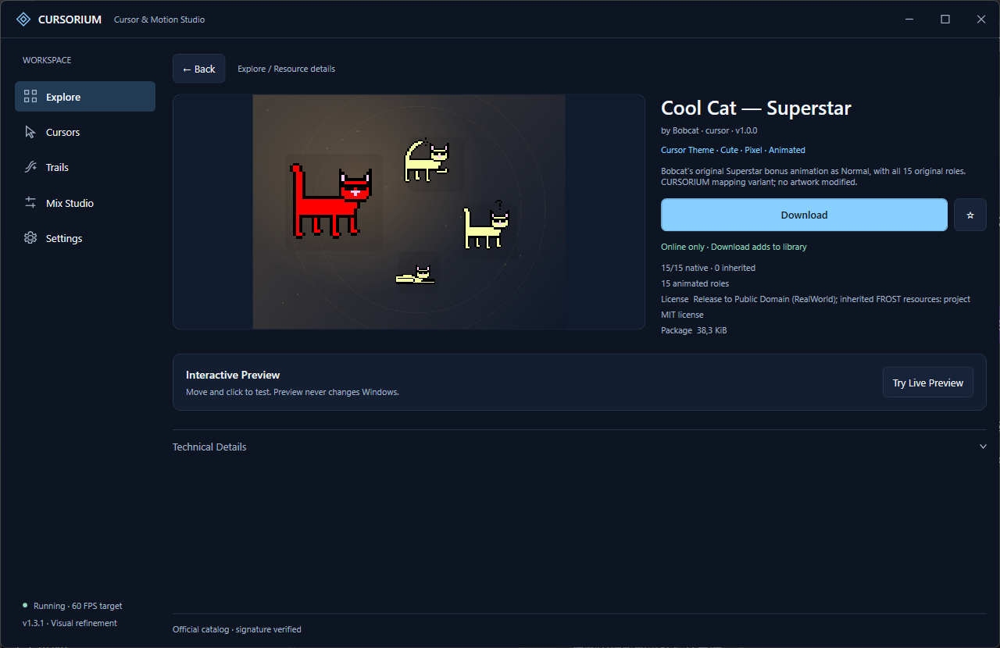

# v1.3.1 实际 WPF 截图与同尺寸对照

全部为运行中的 WPF 窗口屏幕捕获，未使用概念图、合成界面或 AI 素材。普通窗口为 1280×830，详情和本地库使用同一 Cool Cat — Superstar；Trails 使用同一 Sakura Pink 草稿。旧版重新运行已安装 v1.3.0 的隔离检查获取，并非拿另一主题或另一尺寸作对照。

| 页面 | v1.3.0 | v1.3.1 |
|---|---|---|
| Explore | [旧版](images/v1.3.1/before-explore.png) | [新版](images/v1.3.1/explore.png) |
| Theme Details | [旧版](images/v1.3.1/before-details.png) | [新版](images/v1.3.1/details.png) |
| Cursors | [旧版](images/v1.3.1/before-cursors.png) | [新版](images/v1.3.1/cursors.png) |
| Trails | [旧版](images/v1.3.1/before-trails.png) | [新版](images/v1.3.1/trails.png) |

| 其他真实视图 | 截图 |
|---|---|
| 搜索结果 | [search.png](images/v1.3.1/search.png) |
| ANI 临时交互预览 | [ani-preview.png](images/v1.3.1/ani-preview.png) |
| 4× 像素观察，原始 ANI 继续播放 | [observation-4x.png](images/v1.3.1/observation-4x.png) |
| 实际下载 / 校验中 | [download-progress.png](images/v1.3.1/download-progress.png) |
| Installed / Open in Cursors | [download-installed.png](images/v1.3.1/download-installed.png) |
| 五套 Cute 的本地库 | [cute-collection.png](images/v1.3.1/cute-collection.png) |
| Applied 与 Selected · Modified 分别表达 | [applied-vs-selected.png](images/v1.3.1/applied-vs-selected.png) |
| Mix Studio | [mix-studio.png](images/v1.3.1/mix-studio.png) |
| Settings | [settings.png](images/v1.3.1/settings.png) |
| 850×520 Explore | [compact-explore.png](images/v1.3.1/compact-explore.png) |
| 850×520 Details | [compact-details.png](images/v1.3.1/compact-details.png) |
| 1680×980 Explore | [wide-explore.png](images/v1.3.1/wide-explore.png) |
| 1680×980 Details | [wide-details.png](images/v1.3.1/wide-details.png) |

PNG 只能显示 ANI 的一个时刻；原帧顺序、时间和放大后原生 Cursor 不变由实际运行测试验证。资源包较小，下载截图可能在真实 Verifying 阶段捕获，不人为减慢下载或绘制假进度。最大化、最小化还原、托盘和九种等效逻辑工作区由界面检查覆盖。真实物理显示为单屏 2560×1440 / 96 DPI，125%/150% 没有物理切换。
